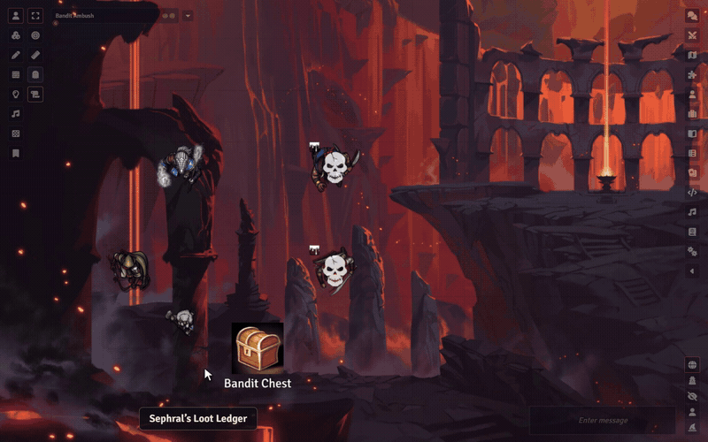

# Sephral’s Loot Ledger

**The dragon is dead and the hoard lies open. Who takes the ring, who carries the rope, and where did the healing potions go?** Loot Ledger gives your group one shared party inventory, a fair way to hand out loot and a log everyone can read, so nothing disappears quietly.

*The demo uses heroes, adversaries and the arena map of Crucible's playtest adventure.*

## Highlights

* **A party inventory that just works:** players put things in and take things out with one click or by dragging them from their sheet. Coins go into a shared party fund.
* **Fair loot:** after a fight the GM collects what the defeated leave behind. Everyone marks *Need*, *Want* or *Pass*, and the loot goes to the strongest claim, then to whoever received the least so far, or to the highest roll.
* **Nothing wanted, nothing lost:** loot nobody claims lands in the party inventory.
* **Every copper counts:** coins are split in equal shares, and the rest goes into the party fund instead of vanishing.
* **An open log:** every item and every coin that changes hands is written into a journal all players can read. Only the GM's client writes it, and any later change shows up.
* **Clean handovers:** equipped, attuned or invested items are taken off on the way, containers keep their contents, and stacks merge.
* **Gifts with consent:** a character can give something to a friend, who accepts or declines first.
* **Your table, your rules:** free access or GM approval, a limit for the party fund, chat messages for everyone or only for the GM. Switch off the loot table, the party fund or the balance, and the Loot Ledger is simply a shared party inventory.

## How it works

1. Enable the module. The GM's client creates the party inventory and the loot log on the first start.
2. Open the Loot Ledger from the token controls or the actor directory.
3. After a fight, collect the loot, let the players claim, and hand it out with one click.

## Good to know

A GM has to be online for anything to change hands. Players can still look at everything.

## Install

Search for **Loot Ledger** in Foundry's module browser or open the [package page](https://foundryvtt.com/packages/sephrals-loot-ledger).

Foundry VTT 13 and 14 · built in support for Crucible and D&D 5e, other systems through a few settings · English and German

## Learn more

Settings, permissions and the support for other systems are explained in the [manual](MANUAL.md). Questions or ideas? Join us on [Discord](https://discord.gg/7BjCgDYaBP). Looking for more? See [all modules by Sephral](https://github.com/Sephral).

## License

See [LICENSE.md](LICENSE.md).
